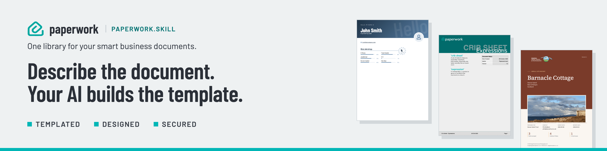

<picture>
  <source media="(prefers-color-scheme: dark)" srcset=".github/images/banner-dark.png">
  
</picture>

<p align="center">
  <a href="https://github.com/richard-scryber/scryber.core">Scryber</a> |
  <a href="https://github.com/paperwork-collective/Paperwork.Core">Core</a> |
  <a href="https://www.nuget.org/packages/Paperwork.CLI">CLI</a> |
  Skill |
  <a href="https://paperwork.design" target="_blank" rel="noopener">Design</a> |
  <a href="https://paperwork.vu" target="_blank" rel="noopener">View</a> |
  <a href="https://paperwork.help/paperwork.skill/" target="_blank" rel="noopener">Help</a> |
  <a href="https://www.paperwork-collective.com" target="_blank" rel="noopener">Corp</a>
</p>

# Paperwork.Skill

**Describe the document. Your AI builds the template.**

Paperwork.Skill makes the [Paperwork CLI](https://www.nuget.org/packages/Paperwork.CLI) available to your AI, so it can design, build and run document creation for you: in the chat or the terminal, from a description of the document you want.


## The Paperwork family

| | What it's for |
|---|---|
| [Scryber.Core](https://github.com/richard-scryber/scryber.core) | The open-source generation engine: templates, and code to create a document. |
| [Paperwork.Core](https://github.com/paperwork-collective/Paperwork.Core) | Embedding generation in your .NET applications, from your own template or a document built in code. |
| [Paperwork.CLI](https://www.nuget.org/packages/Paperwork.CLI) | Creating dynamic documents from your templates automatically, whether referenced or downloaded. |
| **Paperwork.Skill** (this repository) | Making the CLI available to your AI, to design, build and run document creation. |
| [Paperwork.Design](https://paperwork.design) | The online template designer: build, preview and publish your templates. |
| [Paperwork.View](https://paperwork.vu) | The free online PDF viewer for your custom templates and Paperwork designs. |
| [Paperwork.Samples](https://github.com/paperwork-collective/Paperwork.Samples) | The designs and templates from the help files at [paperwork.help](https://paperwork.help), ready to use. |

Documentation for all of them is at [paperwork.help](https://paperwork.help).

---

## What This Skill Does

Once installed, your AI agent can:

- **Author reusable templates** — scaffold HTML layouts, CSS styles, and TemplateConfigV1 JSON configs for any document type (reports, invoices, certificates, letters, statements)
- **Bind fields and data** — wire scalar parameters (dates, names, titles) and JSON data sources (tables, line items, records) into templates using handlebars expressions
- **Generate PDFs on demand** — run a template with per-run data and field overrides to produce a PDF
- **Route output flexibly** — save to a local folder, pipe to an upload command, or do both

Typical workflows:

| Request | What happens |
|---|---|
| *"Create an invoice template with customer name, date, and line items"* | Scaffolds layout + config, validates |
| *"Generate my monthly report for March"* | Finds template, applies overrides, writes PDF |
| *"Create the finance report and save it to my Finance Documents folder"* | Generates PDF, writes to specified path |
| *"Generate the certificate and send it to SharePoint"* | Generates PDF, pipes to upload command |

---

## Prerequisites

| Requirement | Details |
|---|---|
| **.NET 8.0+** | [dotnet.microsoft.com](https://dotnet.microsoft.com/download) |
| **Paperwork CLI** | Install with `dotnet tool install -g Paperwork.CLI` |

Verify the CLI is working:

```bash
paperwork info
```

---

## Installation

### Claude Code — Marketplace (recommended)

```
/plugin marketplace add https://github.com/paperwork-collective/Paperwork.Skill
/plugin install paperwork
```

### Claude Code — Direct clone

```bash
git clone https://github.com/paperwork-collective/Paperwork.Skill
claude --plugin-dir ./Paperwork.Skill
```

### Claude Code — Persistent via `settings.json`

Add to your project's `.claude/settings.json`:

```json
{
  "plugins": {
    "paperwork": {
      "source": {
        "source": "github",
        "repo": "paperwork-collective/Paperwork.Skill"
      }
    }
  }
}
```

---

### Cursor

```bash
git clone --depth 1 https://github.com/paperwork-collective/Paperwork.Skill /tmp/Paperwork.Skill
mkdir -p ~/.cursor/skills
cp -r /tmp/Paperwork.Skill/skills/paperwork ~/.cursor/skills/paperwork
rm -rf /tmp/Paperwork.Skill
```

---

### GitHub Copilot (VS Code)

1. Create `.github/copilot-instructions.md` in your repo.
2. Paste the contents of `skills/paperwork/SKILL.md` into the file.

---

### Windsurf

1. Create `.windsurf/rules/paperwork.md`
2. Paste the body of `skills/paperwork/SKILL.md` (everything after the `---` frontmatter)

---

### Any other agent

`SKILL.md` is plain Markdown. Paste the contents of `skills/paperwork/SKILL.md` into any agent's system prompt or custom instructions field.

---

## Quick Start

### 1. Install the CLI

```bash
dotnet tool install -g Paperwork.CLI
```

### 2. Author a template

Ask your agent:

> *Create an invoice template with fields for date and reference number, and a line items data source*

The agent will scaffold:

```
templates/
└── invoice/
    ├── invoice.json   # TemplateConfigV1 config
    ├── invoice.html   # HTML layout with handlebars bindings
    └── invoice.css    # Styles
```

### 3. Generate a document

> *Generate my invoice for Acme Corp using acme-order.json and save it to ~/Documents/Invoices*

The agent runs:

```bash
paperwork generate --config templates/invoice/invoice.json \
  --data customer=acme-order.json \
  --field date=2026-03-30 \
  --output ~/Documents/Invoices/acme-march-2026.pdf
```

### 4. Pipe to a file service

> *Generate the monthly report and upload it to SharePoint*

```bash
paperwork generate --config templates/monthly-report/monthly-report.json \
  --field month=March --field year=2026 \
  | <your-upload-command> "Finance/Reports/March 2026.pdf"
```

---

## Template Storage

| Scope | Path | Use for |
|---|---|---|
| Project-local | `./templates/<name>/` | Templates specific to one project |
| Global | `~/.paperwork/templates/<name>/` | Shared templates across projects |

---

## Data Binding Reference

```html
<!-- Scalar field -->
<p data-content='{{fields["date"]}}'></p>

<!-- Data object property -->
<p data-content='{{customer.name}}'></p>

<!-- Iterate array -->
{{#each items}}
<tr>
  <td data-content='{{this.description}}'></td>
  <td data-content='{{this.amount}}'></td>
</tr>
{{/each}}

<!-- Conditional -->
{{#if customer.isPremium}}
<p>Premium discount applied.</p>
{{/if}}

<!-- Filtered iteration -->
<template data-bind="{{selectWhere(items, .type == 'taxable')}}">
  <tr><td data-content='{{.description}}'></td></tr>
</template>
```

---

## Links

- [Paperwork CLI](https://www.nuget.org/packages/Paperwork.CLI)
- [TemplateConfigV1 schema](https://paperwork.help/paperwork.cli/config-format.html)
- [Template examples](https://paperwork.help/paperwork.cli/examples.html)

---

## License

MIT
